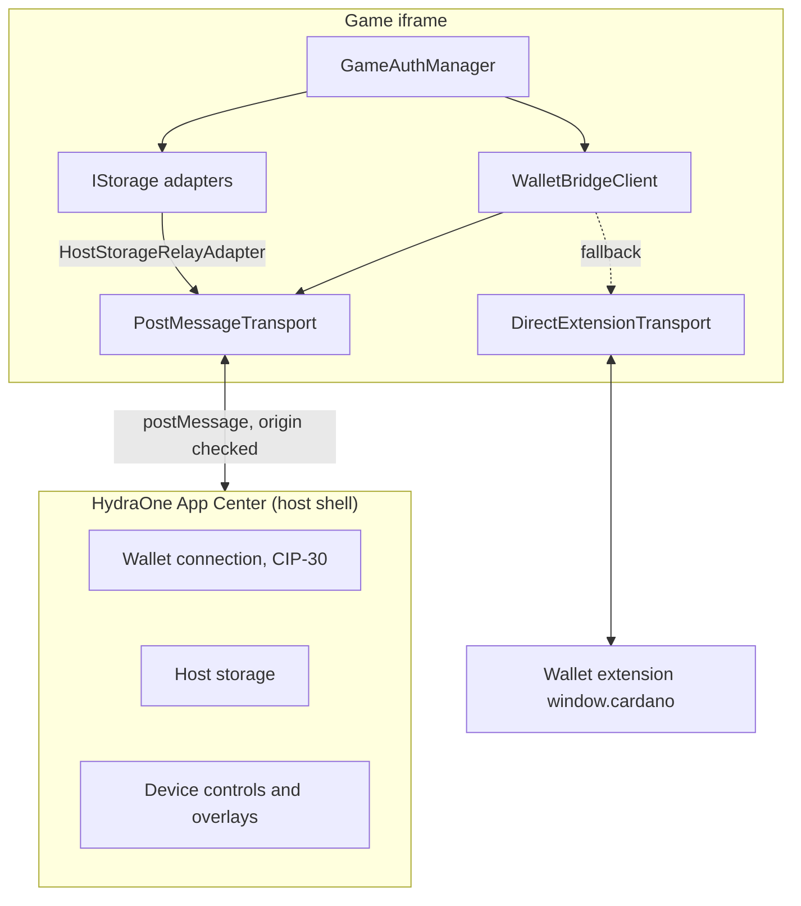

## Two execution modes

The same client code runs in two environments.

1. **Embedded mode.** The game runs in an iframe inside the HydraOne App Center. The SDK talks to the host shell over `postMessage`. The host owns the wallet connection, so the game never sees private keys.
2. **Standalone mode.** The game runs in a normal browser tab. With `fallbackToExtension: true`, the SDK talks directly to a CIP-30 wallet extension on `window.cardano`.

## Core pieces

| Piece                      | Role                                                                                             |
| -------------------------- | ------------------------------------------------------------------------------------------------ |
| `WalletBridgeClient`       | Public entry point. Owns the connection state, request timeouts and host events.                 |
| `ITransport`               | Port with `send`, `onMessage` and optional `destroy`. Everything above it is transport-agnostic. |
| `PostMessageTransport`     | Iframe transport with origin and source validation and request/response correlation.             |
| `DirectExtensionTransport` | Talks to a CIP-30 extension and translates RPC messages into wallet calls.                       |
| `IStorage`                 | Port for async key-value storage.                                                                |
| `GameAuthManager`          | CIP-8 login and JWT lifecycle on top of a client and a storage.                                  |

Ports (`ITransport`, `IStorage`) keep the core free of browser details. That is why the same client works against the iframe host and against an extension.

## Next steps

- [Connection lifecycle](/core-concepts/connection-lifecycle) for how a connection is chosen and released.
- [Message protocol](/core-concepts/message-protocol) for the wire format.
- [Security model](/core-concepts/security-model) for what the SDK validates.
