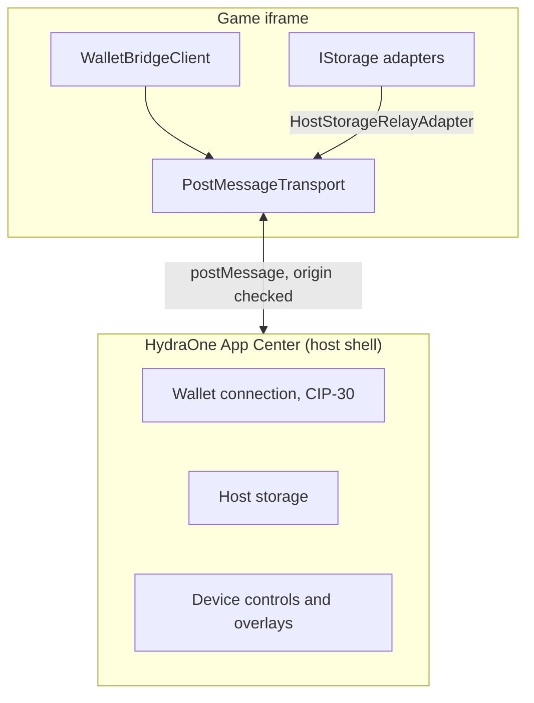

## Two sides of the bridge

- **The game (client).** Runs in an iframe and uses `@hydraone-sdk/core`. It talks to the host shell over `postMessage`.
- **The host.** Runs in the page that embeds the game, for example the HydraOne App Center, and uses `@hydraone-sdk/host`. It owns the wallet connection, so the game never sees private keys.

Opened in a normal browser tab, a game has no host to talk to, and `init()` rejects with `ERR_NOT_IN_IFRAME`.

## Core pieces

| Piece                      | Role                                                                                             |
| -------------------------- | ------------------------------------------------------------------------------------------------ |
| `WalletBridgeClient`       | Public entry point. Owns the connection state, request timeouts and host events.                 |
| `ITransport`               | Port with `send`, `onMessage` and optional `destroy`. Everything above it is transport-agnostic. |
| `PostMessageTransport`     | Iframe transport with origin and source validation and request/response correlation.             |
| `IStorage`                 | Port for async key-value storage.                                                                |

Ports (`ITransport`, `IStorage`) keep the core free of browser details. That is why the client can be tested against any transport, including a mock.

## Next steps

- [Connection lifecycle](/core-concepts/connection-lifecycle) for how a connection is chosen and released.
- [Message protocol](/core-concepts/message-protocol) for the wire format.
- [Security model](/core-concepts/security-model) for what the SDK validates.
