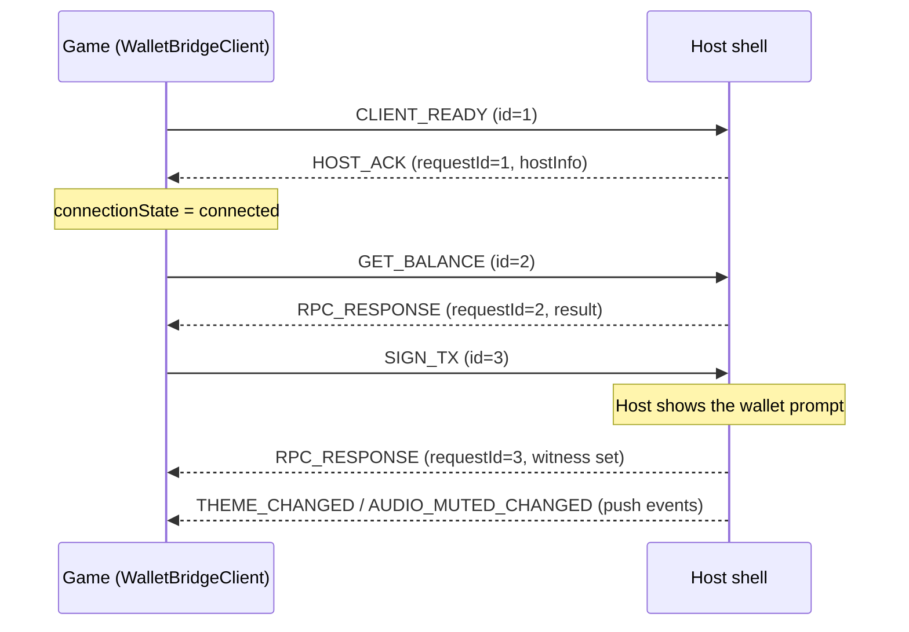

In embedded mode the game and the host shell talk over `postMessage`. You rarely touch the protocol directly because `WalletBridgeClient` wraps it, but it helps when you debug or build a host.

## Envelope

Every message shares one envelope:

```ts
interface BridgeMessage<T = unknown> {
  id: string; // correlation ID (UUID when available)
  type: string; // for example 'GET_BALANCE'
  payload?: T;
  timestamp: number;
  source: 'hydra-client' | 'hydra-host';
}
```

## Requests and responses

A request gets a unique `id`. The host answers with an `RPC_RESPONSE` (or `RPC_ERROR`) whose payload carries the same `requestId`. Responses are matched by ID, so concurrent requests cannot be mixed up, and a response for a request that has already timed out is discarded.



## Message types

| Group          | Types                                                                                                                  |
| -------------- | ---------------------------------------------------------------------------------------------------------------------- |
| Handshake      | `CLIENT_READY`, `HOST_ACK`, `PING`                                                                                     |
| Wallet queries | `GET_USED_ADDRESSES`, `GET_UNUSED_ADDRESSES`, `GET_CHANGE_ADDRESS`, `GET_NETWORK_ID`, `GET_UTXOS`, `GET_BALANCE`, `GET_COLLATERAL` |
| Signing        | `SIGN_TX`, `SUBMIT_TX`, `SIGN_DATA`                                                                                    |
| Host controls  | `SET_ORIENTATION`, `TRIGGER_HAPTIC`, `REQUEST_DEPOSIT_MODAL`, `GET_PLAYER_PROFILE`                                     |
| Push events    | `AUDIO_MUTED_CHANGED`, `THEME_CHANGED`, `AUTH_STATE_CHANGED`, `NETWORK_CHANGED`, `ACCOUNT_CHANGED`, `DISCONNECTED`     |
| Host storage   | `HOST_STORAGE_GET`, `HOST_STORAGE_SET`, `HOST_STORAGE_REMOVE`, `HOST_STORAGE_CLEAR`                                    |
| Replies        | `RPC_RESPONSE`, `RPC_ERROR`                                                                                            |

## Next steps

- [Security model](/core-concepts/security-model) for how origins and sources are validated.
- [Errors](/reference/errors) for how `RPC_ERROR` maps to SDK error classes.
