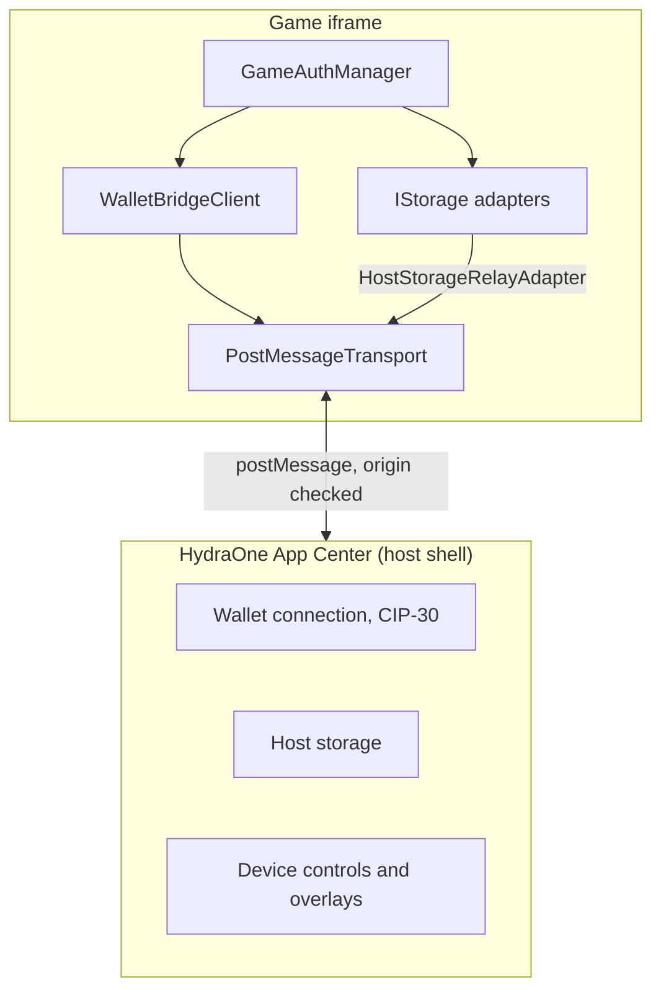

## Hai phía của cầu nối

- **Game (client).** Chạy trong một iframe và dùng `@hydraone-sdk/core`. Nó giao tiếp với host shell qua `postMessage`.
- **Host.** Chạy trong trang nhúng game, ví dụ HydraOne App Center, và dùng `@hydraone-sdk/host`. Host sở hữu kết nối ví, nên game không bao giờ thấy private key.

Khi mở trong một tab trình duyệt thông thường, game không có host để giao tiếp và `init()` bị reject với `ERR_NOT_IN_IFRAME`.

## Các thành phần cốt lõi

| Thành phần                 | Vai trò                                                                                                   |
| -------------------------- | --------------------------------------------------------------------------------------------------------- |
| `WalletBridgeClient`       | Điểm vào công khai. Quản lý trạng thái kết nối, timeout của request và sự kiện từ host.                   |
| `ITransport`               | Port với `send`, `onMessage` và `destroy` (tùy chọn). Mọi thứ phía trên nó không phụ thuộc vào transport. |
| `PostMessageTransport`     | Transport cho iframe, có kiểm tra origin và source cùng việc ghép cặp request/response.                   |
| `IStorage`                 | Port cho storage key-value bất đồng bộ.                                                                   |
| `GameAuthManager`          | Đăng nhập CIP-8 và vòng đời JWT, xây trên một client và một storage.                                      |

Các port (`ITransport`, `IStorage`) giữ cho phần lõi không phụ thuộc chi tiết của trình duyệt. Nhờ vậy client có thể được kiểm thử với bất kỳ transport nào, kể cả transport giả.

## Bước tiếp theo

- [Vòng đời kết nối](/vi/core-concepts/connection-lifecycle) về cách một kết nối được chọn và giải phóng.
- [Giao thức thông điệp](/vi/core-concepts/message-protocol) về định dạng trên đường truyền.
- [Mô hình bảo mật](/vi/core-concepts/security-model) về những gì SDK kiểm tra.
