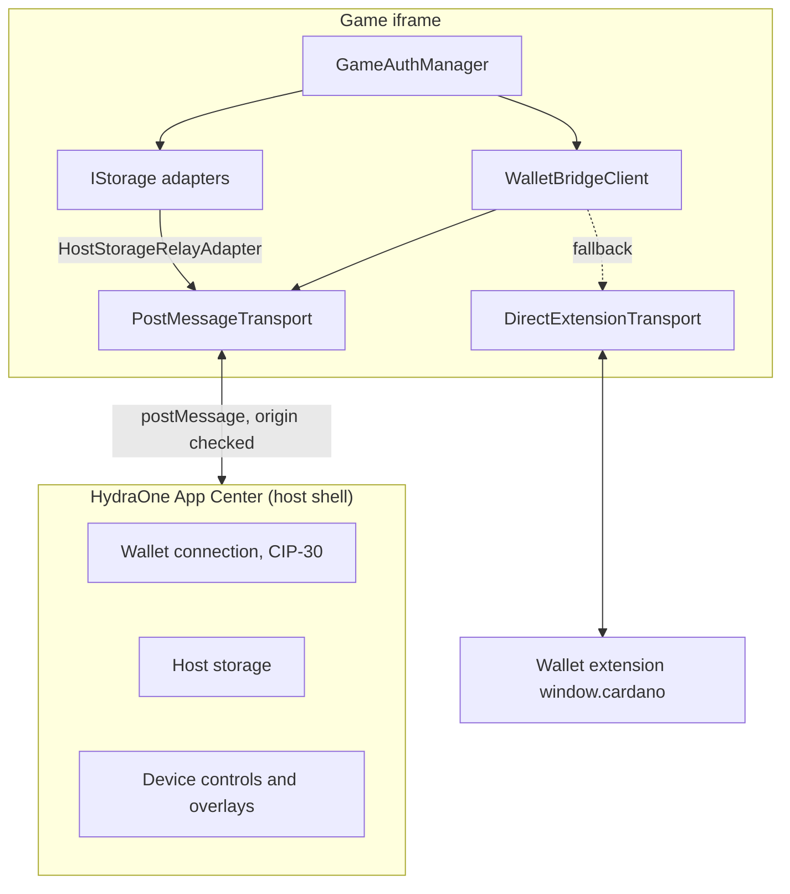

## Hai chế độ thực thi

Cùng một đoạn code client chạy được trong hai môi trường.

1. **Embedded mode.** Game chạy trong iframe bên trong HydraOne App Center. SDK trao đổi với host shell qua `postMessage`. Host nắm giữ kết nối ví nên game không bao giờ thấy private key.
2. **Standalone mode.** Game chạy trong một tab trình duyệt thông thường. Với `fallbackToExtension: true`, SDK làm việc trực tiếp với extension ví CIP-30 trên `window.cardano`.

## Các thành phần cốt lõi

| Thành phần                 | Vai trò                                                                                                   |
| -------------------------- | --------------------------------------------------------------------------------------------------------- |
| `WalletBridgeClient`       | Điểm vào công khai. Quản lý trạng thái kết nối, timeout của request và sự kiện từ host.                   |
| `ITransport`               | Port với `send`, `onMessage` và `destroy` (tùy chọn). Mọi thứ phía trên nó không phụ thuộc vào transport. |
| `PostMessageTransport`     | Transport cho iframe, có kiểm tra origin và source cùng việc ghép cặp request/response.                   |
| `DirectExtensionTransport` | Làm việc với extension CIP-30 và chuyển các RPC message thành lời gọi ví.                                 |
| `IStorage`                 | Port cho storage key-value bất đồng bộ.                                                                   |
| `GameAuthManager`          | Đăng nhập CIP-8 và vòng đời JWT, xây trên một client và một storage.                                      |

Các port (`ITransport`, `IStorage`) giữ cho phần lõi không phụ thuộc chi tiết của trình duyệt. Nhờ vậy cùng một client chạy được với host trong iframe lẫn với một extension.

## Bước tiếp theo

- [Vòng đời kết nối](/vi/core-concepts/connection-lifecycle) về cách một kết nối được chọn và giải phóng.
- [Giao thức thông điệp](/vi/core-concepts/message-protocol) về định dạng trên đường truyền.
- [Mô hình bảo mật](/vi/core-concepts/security-model) về những gì SDK kiểm tra.
