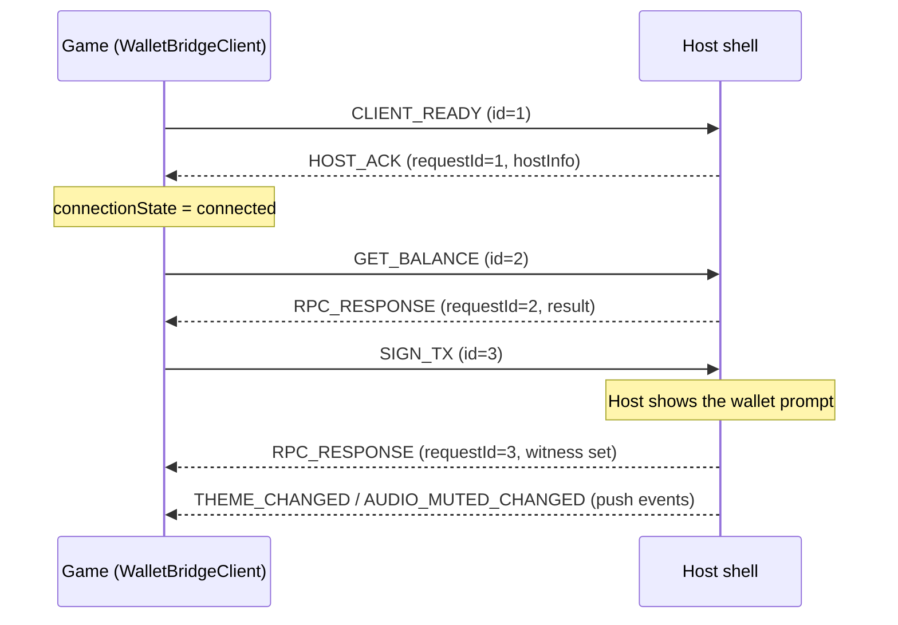

Ở embedded mode, game và host shell trao đổi với nhau qua `postMessage`. Bạn hiếm khi phải đụng tới giao thức trực tiếp vì `WalletBridgeClient` đã bọc nó, nhưng hiểu nó sẽ giúp khi bạn debug hoặc xây một host.

## Envelope

Mọi thông điệp dùng chung một envelope:

```ts
interface BridgeMessage<T = unknown> {
  id: string; // correlation ID (UUID when available)
  type: string; // for example 'GET_BALANCE'
  payload?: T;
  timestamp: number;
  source: 'hydra-client' | 'hydra-host';
}
```

## Request và response

Mỗi request có một `id` riêng. Host trả lời bằng `RPC_RESPONSE` (hoặc `RPC_ERROR`) với payload mang cùng `requestId`. Response được ghép cặp theo ID nên các request đồng thời không thể bị lẫn, và response của một request đã timeout sẽ bị bỏ qua.



## Các loại thông điệp

| Nhóm            | Loại                                                                                                                                                                             |
| --------------- | -------------------------------------------------------------------------------------------------------------------------------------------------------------------------------- |
| Handshake       | `CLIENT_READY`, `HOST_ACK`, `PING`                                                                                                                                               |
| Truy vấn ví     | `GET_USED_ADDRESSES`, `GET_UNUSED_ADDRESSES`, `GET_CHANGE_ADDRESS`, `GET_REWARD_ADDRESSES`, `GET_NETWORK_ID`, `GET_UTXOS`, `GET_BALANCE`, `GET_BALANCE_ASSETS`, `GET_COLLATERAL` |
| Ký              | `SIGN_TX`, `SUBMIT_TX`, `SIGN_DATA`                                                                                                                                              |
| Điều khiển host | `SET_ORIENTATION`, `TRIGGER_HAPTIC`, `REQUEST_DEPOSIT_MODAL`, `GET_PLAYER_PROFILE`                                                                                               |
| Push event      | `AUDIO_MUTED_CHANGED`, `THEME_CHANGED`, `AUTH_STATE_CHANGED`, `NETWORK_CHANGED`, `ACCOUNT_CHANGED`, `DISCONNECTED`                                                               |
| Host storage    | `HOST_STORAGE_GET`, `HOST_STORAGE_SET`, `HOST_STORAGE_REMOVE`, `HOST_STORAGE_CLEAR`                                                                                              |
| Phản hồi        | `RPC_RESPONSE`, `RPC_ERROR`                                                                                                                                                      |

## Bước tiếp theo

- [Mô hình bảo mật](/vi/core-concepts/security-model) về cách origin và source được kiểm tra.
- [Lỗi](/vi/reference/errors) về cách `RPC_ERROR` được ánh xạ sang các lớp lỗi của SDK.
